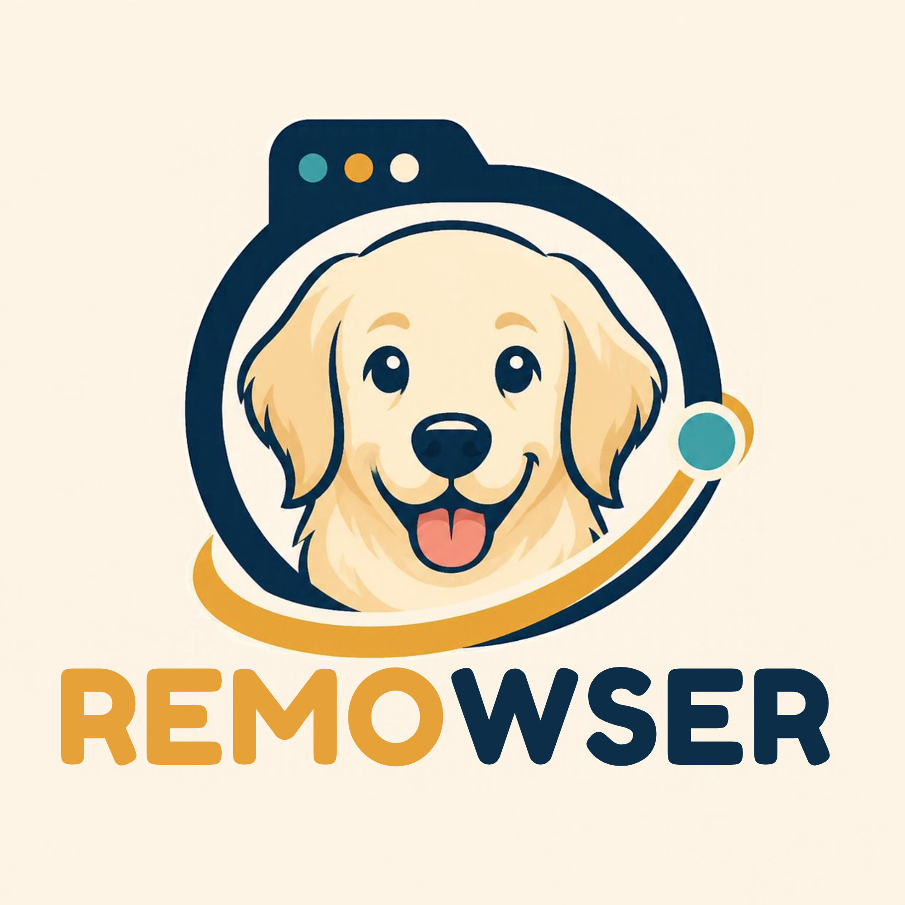

# 🪐 REMOWSER – Local Autonomous AI Browser

<p align="center">
  
</p>

<p align="center">
  <strong>An open-source, local AI-powered autonomous browser running entirely on-device.</strong><br>
  Built with Electron, React, TypeScript, Playwright, and local quantized LLMs (Qwen2.5 / Llama 3.1) via Ollama.
</p>

<p align="center">
  <a href="#-quick-start-one-click-run"></a>
  <a href="#-architecture"></a>
  <a href="#-recommended-hardware"></a>
  <a href="#-license"></a>
</p>

---

## ⚡ Overview

**REMOWSER** is an autonomous browser designed to execute multi-step web research, navigation, form filling, and data extraction completely on your local machine—with **zero cloud API costs** and **zero data telemetry**.

Powered by a local model named **REMO** (targeting `qwen2.5:3b`, `qwen2.5:7b-instruct-q4_0`, or `llama3.1:8b`), REMOWSER combines an interactive Chromium web browser with an autonomous agent sidebar that executes complex tasks in the background without hijacking your active viewport.

---

## 🚀 Quick Start (One-Click Run)

You do **not** need to open a terminal every time you use REMOWSER. The local LLM engine and browser controller initialize automatically in the background.

### Option 1: Desktop Shortcut
Double-click the **REMOWSER** icon on your desktop:
```bash
~/Desktop/REMOWSER.desktop
```

### Option 2: Application Menu
Search for **REMOWSER** in your Linux application launcher (press `Super` / `Windows` key and type `REMOWSER`).

### Option 3: Double-Click the AppImage
Navigate to the project's `dist/` folder in your file manager and double-click:
```bash
/home/senju/Documents/REMoWSER/dist/REMOWSER-0.1.0.AppImage
```

---

## 🏗️ Core Architecture & Systems

```
┌────────────────────────────────────────────────────────────────────────┐
│                        REMOWSER BROWSER SHELL                          │
│  [🪐 REMOWSER] [DuckDuckGo +] [ < > ↻ ] [ 🛡️ Omnibox ] [ ⚡ REMO Agent ]│
├──────────────────────────────────────┬─────────────────────────────────┤
│                                      │   REMOWSER AI SIDEBAR           │
│                                      │ • Status: ⚡ REMO Online        │
│          EMBEDDED CHROMIUM           │ • Model: Qwen2.5 Local @ 11434  │
│               WEBVIEW                │ • Task Queue (Async Background) │
│  (Interactive web browsing with      │ • Action Cards & Extracted Data │
│   built-in ad/tracker blocking)      │ • Security Checkpoint Intercept │
│                                      │ • Natural Language Prompt Area  │
└──────────────────────────────────────┴─────────────────────────────────┘
                                   │
              Auto-Starts & Connects in the Background
                                   ▼
        [Ollama Engine @ Port 11434]  +  [Playwright Controller]
        (Auto-spawns if not active)       (Automated click/type/scroll)
```

### 1. System A: Browser Shell & Task Manager
- **Browser Viewport**: An embedded Chromium `<webview>` partitioned with persistence (`partition="persist:remowser"`), tab strip, back/forward/reload controls, and an omnibox URL address bar.
- **Sidebar UI**: Fixed right-hand React interface providing live status updates from IPC events (*"Navigating to Newegg..."* → *"Reading DOM..."* → *"Clicking search input #14"*).
- **Asynchronous Task Queue**: Supports queueing multi-step tasks (e.g. *"Find best price for RTX 4070 on Newegg"* or *"Search weather in Tokyo"*) and reviewing previous results.

### 2. System B: DOM Simplification Engine
- **Injected Payload** ([`domSimplifier.js`](src/agents/domSimplifier.js)): Executed on the target page prior to sending context to REMO.
- Strips `<style>`, `<script>`, `<svg>`, `<iframe>`, `<noscript>`, and invisible elements (evaluating computed display, visibility, opacity, and bounding boxes).
- Identifies interactable elements (`button`, `input`, `a[href]`, `textarea`, `select`, `[role="button"]`), assigning each an incremental integer attribute:
  ```html
  data-remowser-id="12"
  ```
- Generates a compact Markdown page representation (typically < 2,000 tokens), preventing context overflow and reducing memory consumption on local models.

### 3. System C: Autonomous Background Execution & Action Loop
- **Observe-Decide-Act Loop**: Spawns isolated Playwright Chromium contexts that navigate and execute actions in the background without disturbing whatever tab you are currently reading.
- **Strict JSON Tool Calling Schema**:
  ```json
  {
    "thought": "Reasoning for the next action",
    "action": "open_tab" | "switch_tab" | "click" | "type" | "scroll" | "extract_data" | "task_complete",
    "url": "https://...",
    "id": 12,
    "text": "search query",
    "direction": "down",
    "target": "target description",
    "message": "Final completion summary"
  }
  ```
- Maps the agent's target `id` back to the live DOM node (`[data-remowser-id="${id}"]`) and simulates native clicks, keystrokes, and scrolling.

### 4. System D: Security Boundaries & Human-in-the-Loop Interceptor
- Heuristically detects:
  - **Captchas**: Cloudflare Turnstile, Google reCAPTCHA, hCaptcha, Arkose Labs, or textual bot prompts.
  - **Authentication Forms**: Password inputs and login forms.
  - **Critical Transactions**: Checkout, payment, and order submission buttons.
- **Behavior**: Pauses the autonomous loop, emits `human-verification-required`, surfaces the page into your visible browser view, and displays an **"Approve / Resume Agent"** banner in the sidebar.

### 5. Built-in Ad & Tracker Blocker
- Integrates an Electron session-level network request filter blocking common advertising, analytics, and tracking networks (`doubleclick`, `googleadservices`, `adnxs`, `outbrain`, `taboola`, etc.).

---

## 💻 Hardware Requirements

Designed to run smoothly on modest laptops:

| Component | Minimum Specification | Recommended Specification |
| :--- | :--- | :--- |
| **Processor** | Intel Core i3 (10th Gen+) / AMD Ryzen 3 | Intel Core i3 15th Gen / Ryzen 5 |
| **RAM** | 8 GB RAM (for 3B models) | 16 GB RAM (for 7B/8B models) |
| **Storage** | 10 GB available SSD space | 20 GB available SSD space |
| **Operating System** | Linux (Ubuntu, CachyOS, Arch, Fedora) / Windows 10+ | Linux x86_64 |
| **AI Backend** | Ollama 0.3+ | Ollama 0.35+ |

---

## 🧠 Local Model Setup (REMO)

REMOWSER automatically detects and binds to your local Ollama instance on `http://localhost:11434`.

### Recommended Quantized Models:
```bash
# Fastest on 16GB RAM i3 laptops (Ultra-low latency, ~1.9 GB)
ollama pull qwen2.5:3b

# Best reasoning and tool calling accuracy (~4.7 GB)
ollama pull qwen2.5:7b-instruct-q4_0

# High-accuracy alternative (~4.9 GB)
ollama pull llama3.1:8b-instruct-q4_0
```

> **Note**: If Ollama is not already running, REMOWSER will automatically spawn `ollama serve` in the background when launched.

---

## 🛠️ Developer & Build Guide

### 1. Prerequisites
Ensure you have Node.js 20+ and npm installed:
```bash
node -v   # v20+ recommended
npm -v
```

### 2. Clone & Install Dependencies
```bash
git clone https://github.com/your-username/REMoWSER.git
cd REMoWSER
npm install
```

### 3. Install Playwright Browsers
```bash
npx playwright install chromium
```

### 4. Run in Development Mode
Compiles the main process via `tsc`, bundles React with `esbuild`, copies static assets, and boots Electron:
```bash
npm start
# or: npm run dev
```

### 5. Package as Standalone AppImage
To generate a self-contained, double-clickable Linux executable:
```bash
npm run dist
```
The output executable will be generated at:
```bash
dist/REMOWSER-0.1.0.AppImage
```

---

## 📂 Project Structure

```
REMoWSER/
├── assets/                     # Application icons and logos
│   └── icon.png
├── dist/                       # Compiled production binaries & AppImage
│   ├── REMOWSER-0.1.0.AppImage # Standalone executable
│   ├── main.js
│   ├── preload.js
│   └── renderer/
│       ├── bundle.js           # Compiled React bundle (esbuild)
│       ├── bundle.css
│       └── index.html
├── src/
│   ├── main.ts                 # Electron main process, CDP & agent loop
│   ├── preload.ts              # Secure contextBridge IPC exposure
│   ├── agents/
│   │   └── domSimplifier.js    # DOM stripping, REMOWSER_ID & security scan
│   ├── renderer/
│   │   ├── App.tsx             # Browser chrome & Comet sidebar UI
│   │   ├── App.css             # Dark theme styling & animations
│   │   ├── index.tsx           # React entrypoint
│   │   └── index.html          # HTML shell
│   └── types/
│       └── ipc.d.ts            # Shared TypeScript IPC definitions
├── package.json
└── tsconfig.json
```

---

## ❓ Troubleshooting & FAQ

### 1. The window opened with a blank/white screen
- **Solution**: The React renderer bundle must be compiled. Run `npm run build` to ensure `dist/renderer/bundle.js` and `bundle.css` exist.

### 2. "Address already in use (98)" on Port 9222
- **Solution**: Another instance of REMOWSER or Chrome remote debugging is running. Run:
  ```bash
  killall -9 remowser
  ```

### 3. Agent tasks show "Could not connect to REMO LLM"
- **Solution**: Verify Ollama is reachable:
  ```bash
  curl http://localhost:11434/api/tags
  ```
  If not running, launch it with `ollama serve &` or restart REMOWSER (which auto-spawns it).

### 4. Playwright missing system libraries on Linux
- **Solution**: Install the required Chromium runtime libraries:
  ```bash
  # Debian/Ubuntu:
  sudo apt-get install -y libicu74 libflite1
  
  # Arch/CachyOS:
  sudo pacman -Sy icu libflite
  ```

---

## 📄 License

This project is licensed under the [MIT License](LICENSE).
